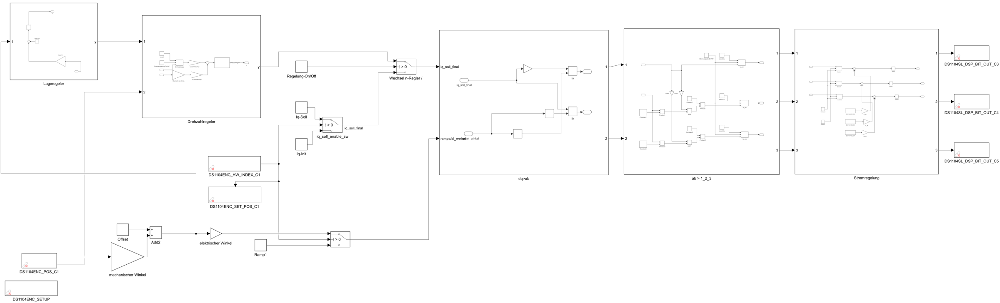
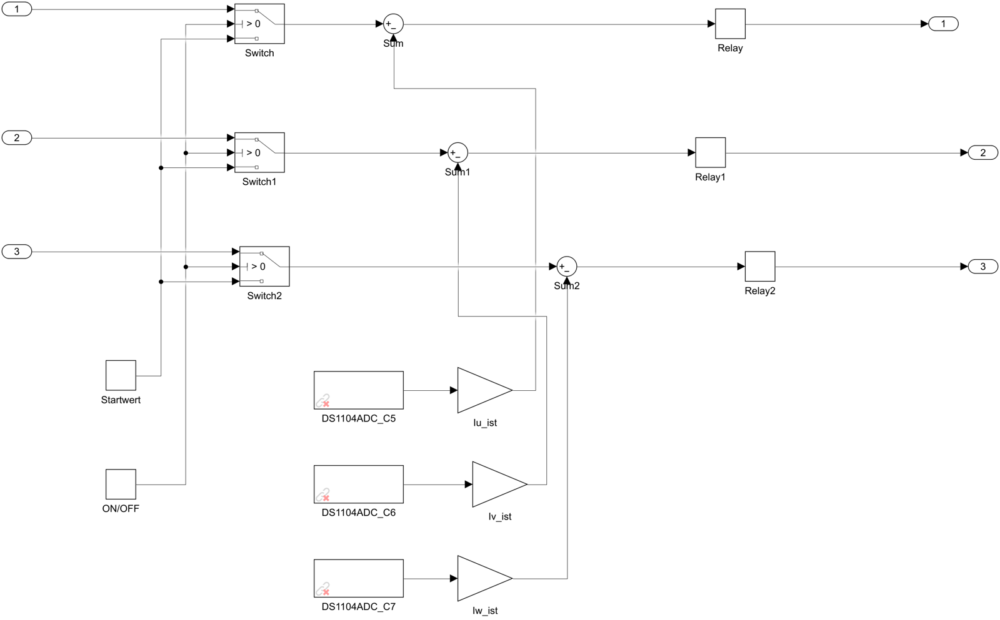
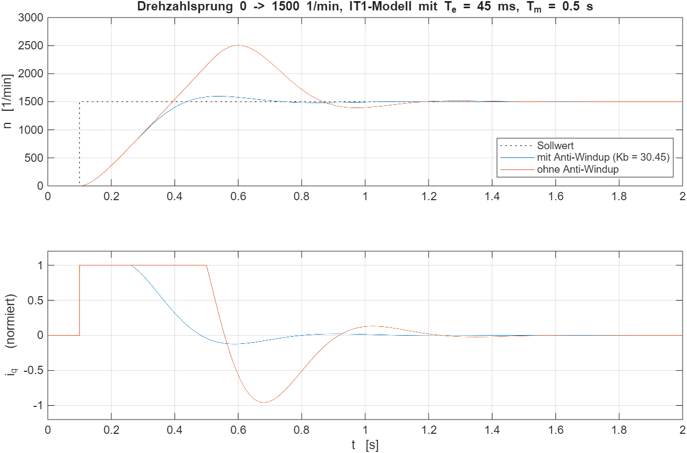

# Feldorientierte Regelung einer PSM auf dSPACE DS1104

Simulink-Modell für die feldorientierte Regelung einer permanentmagneterregten Synchronmaschine (6-polig, p = 3). Das Modell wird über RTI1104 gebaut und läuft auf einer dSPACE DS1104 am echten Motor.

Laborübung Regelungstechnik und Antriebstechnik, M.Sc. Mechatronik, FH Wiener Neustadt, WS 2025/26. Gruppenarbeit (3 Personen). Der Stand im Repo ist der vom Labor am 19.02.2026.



Die rot markierten Blöcke sind die DS1104 I/O-Blöcke (Encoder, ADC, Digitalausgänge). Ohne installiertes RTI1104 zeigt Simulink sie als "not found".

## Kaskade

Von außen nach innen:

1. **Lageregler**: P-Regler, Kp = 1000. Istlage = Encoderwinkel / 2pi, also in Umdrehungen. Ausgang ist die Solldrehzahl.
2. **Drehzahlregler**: PI, Kp = 5.52, Ki = 30.45, Ausgang auf +-1 begrenzt (normierter q-Strom), Anti-Windup mit Back-Calculation (Kb = 30.45). Drehzahl normiert auf 3000 1/min.
3. **dq -> alpha/beta**: mit id = 0 bleibt nur `i_alpha = -iq*sin(gamma_el)`, `i_beta = iq*cos(gamma_el)`.
4. **alpha/beta -> 1, 2, 3**: drei Strangströme, um 120° versetzt.
5. **Stromregelung**: pro Strang ein Zweipunktregler (Relay, Schaltschwellen +-0.1). Die drei Ausgänge gehen direkt auf die Digitalausgänge der DS1104 und schalten den Wechselrichter.



## Messung und Normierung

- Strom: Strommessbox mit 0,8 V/A auf ADC C5 bis C7. Normiert so, dass 1 dem Scheitelwert des Nennstroms entspricht (2 A eff).
- Winkel: Inkrementalgeber mit 1024 Strichen, 4-fach ausgewertet = 4096 Schritte pro Umdrehung. Elektrischer Winkel = 3 * (mechanischer Winkel + Offset).
- Offset: Nach dem Indexpuls einen festen Stromzeiger anlegen (i1 = 1, i2 = i3 = -0.5), der Rotor dreht sich auf die d-Achse. Der Encoderwinkel in dieser Lage ist der Offset, gemessen 0.53 rad.
- Drehzahl aus den Encoderschritten pro Abtastschritt: `n = Schritte * 60 / (ta * 4096)` in 1/min.

## Auslegung Drehzahlregler

Stromregelkreis plus Motor als IT1-Strecke:

```
G(s) = 1 / (s*Tm * (1 + s*Te))
```

- Te = 45 ms: Ersatzzeitkonstante aus dem Stromanstieg, gemessen bei 50, 100 und 200 V, Mittelwert
- Tm ≈ 0,5 s: Anlaufzeit, mit iq = 1 ist der Motor nach etwa 0,5 s auf 3000 1/min

Symmetrisches Optimum: Kp = Tm / (2 Te) = 5.52, Ti = 4 Te = 0.18 s, also Ki = Kp / Ti = 30.45.

Simulation dieses IT1-Modells mit dem Regler, einmal mit und einmal ohne Anti-Windup (`sim/drehzahlkreis_sim.m`):



Beim Sprung auf 1500 1/min steht der Regler am Anfang an der Begrenzung. Ohne Anti-Windup integriert der I-Anteil weiter und die Drehzahl schießt um 67 % über, mit Back-Calculation sind es 6,5 %. Das ist nur das vereinfachte Modell, keine Messung am Prüfstand.

## Schalter im Modell

Fürs Anlaufen und Testen gibt es Umschalter: Rampe statt Encoderwinkel (Motor dreht gesteuert ohne Regelung), feste Stromvorgabe für die Offset-Messung, Iq direkt vorgeben oder vom Drehzahlregler nehmen.

## Verlauf

- Nov 2025: erste reine Simulation mit Streckenmodell (`psm_stromregelung.slx`, in der Git-Historie)
- Jan 2026: Umbau auf dSPACE, Stromregelung, Transformation und Drehzahlregler am Motor
- Feb 2026: Lageregler dazu, Drehzahlregler als eigenes Subsystem, Stand vom Laborprotokoll

## Dateien

```
Stromregelkreis.slx     Simulink Modell (gespeichert mit R2025a, dSPACE RTI1104 zum Bauen)
Project_002/            ControlDesk Projekt mit dem Layout vom Labor
sim/                    Simulation Drehzahlkreis (reines MATLAB, ohne dSPACE)
docs/                   Bilder
```

Die Abtastzeit `ta` muss vor dem Build im Workspace stehen. Die RTI-Build-Dateien sind nicht im Repo, die erzeugt RTI beim Bauen neu.
